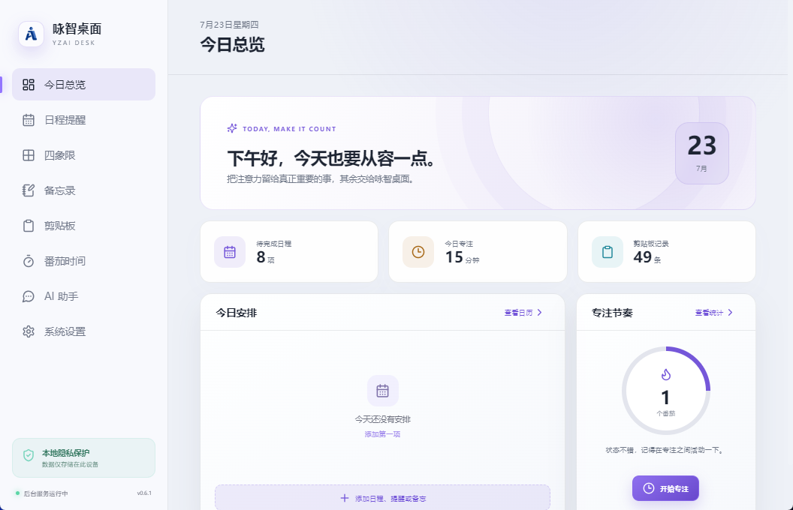
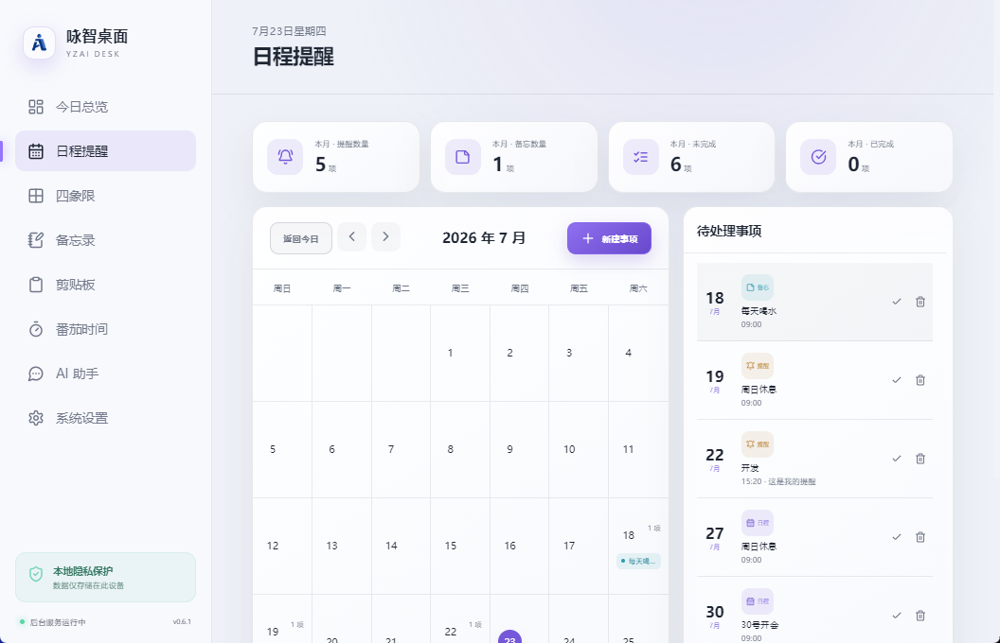
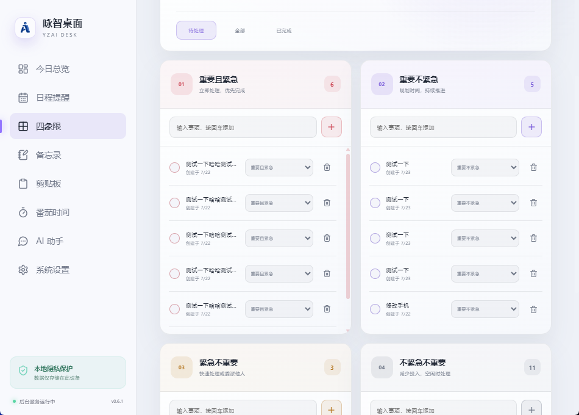
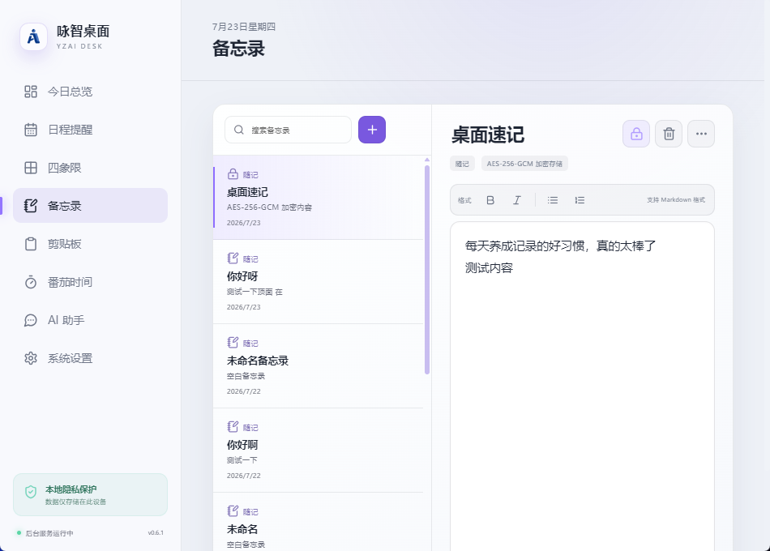
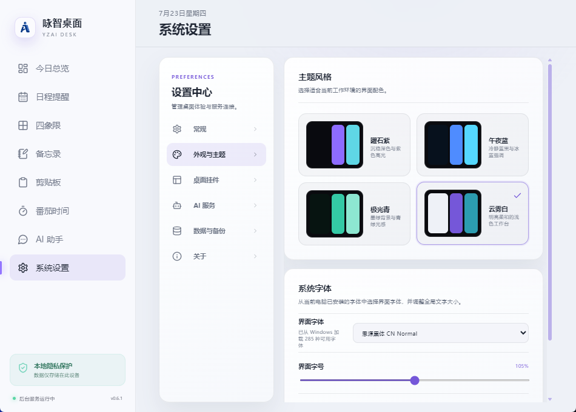
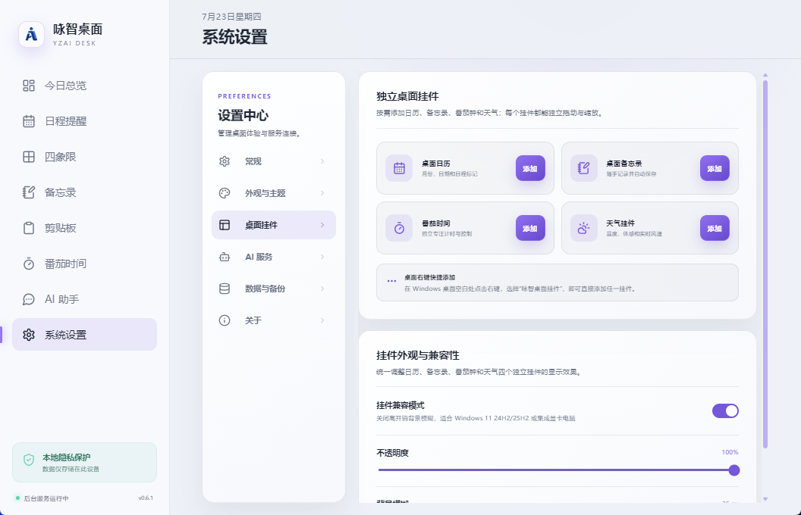
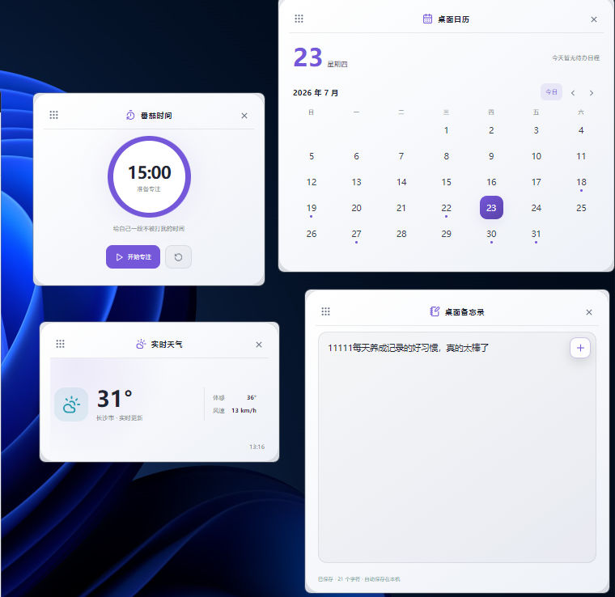

<div align="center">
  
  <h1>咏智桌面工具（YZai Desk）</h1>
  <p>把日程、四象限、备忘录、专注计时、剪贴板和 AI 助手放进一个轻量的 Windows 桌面工作台。</p>
  <p>
    <strong>当前版本：V1.0.0</strong>
    · Windows 10 / 11
    · 本地优先
    · Tauri + React
  </p>
</div>

## 项目简介

咏智桌面工具是一款面向个人效率场景的 Windows 桌面应用。主要数据默认保存在本机，常用功能可从主窗口、系统托盘和桌面挂件快速访问。

开发这款软件主要是给我团队使用，方便管理提醒工作和效率，欢迎使用和体验，后续只做更新维护，免费开放下载。

V1.0.0 正式版保留日历、备忘录、专注和天气挂件，支持尺寸预设、自由摆放、吸附对齐、位置锁定和布局恢复。桌面图标分组功能已移除，升级不会主动移动或删除桌面文件和图标。

V0.6.9 在番茄时间页面和桌面挂件中加入 15 分钟、30 分钟与 1–240 分钟自定义时长；计时期间需先重置才能更改时长。

挂件使用和验证说明见 [桌面挂件布局](./docs/widget-layout-improvements.md)。

V0.6.8 加强数据保护和跨窗口同步：损坏数据不再回退覆盖，支持冲突检测、恢复前备份、Windows 本机密钥加密；改进重复提醒、番茄钟同步、挂件位置恢复、天气请求和 AI 生成控制。

V0.6.7 修复全新安装或删除最后一条记录后，空备忘录页面因读取不存在的草稿而显示“此页面暂时无法显示”的问题。备忘录现在可以稳定显示空状态，并正常完成首次新建、删除最后一条及旧数据兼容流程。

V0.6.6 修正 Agnes AI 服务为 OpenAI 兼容的文本生成模型，预置 `agnes-2.5-flash`、`agnes-2.0-flash`、`agnes-2.5-pro`；移除重复的协议切换按钮，仅保留“协议类型”下拉选择。DeepSeek（OpenAI / Anthropic）、Kimi、OpenAI、Anthropic 与第三方兼容服务的配置方式保持不变。

## 界面预览

### 今日总览



<table>
  <tr>
    <td align="center" width="50%">
      <br>
      <strong>日期提醒</strong>
    </td>
    <td align="center" width="50%">
      <br>
      <strong>四象限任务</strong>
    </td>
  </tr>
  <tr>
    <td align="center">
      <br>
      <strong>备忘录</strong>
    </td>
    <td align="center">
      <br>
      <strong>番茄时间</strong>
    </td>
  </tr>
  <tr>
    <td align="center">
      <br>
      <strong>AI 助手</strong>
    </td>
    <td align="center">
      <br>
      <strong>主题外观</strong>
    </td>
  </tr>
  <tr>
    <td align="center">
      <br>
      <strong>桌面挂件设置</strong>
    </td>
    <td align="center">
      <br>
      <strong>桌面挂件</strong>
    </td>
  </tr>
</table>

## 核心能力

| 模块 | 能力 |
| --- | --- |
| 今日总览 | 汇总待办、提醒、专注数据和常用入口 |
| 日期提醒 | 日历浏览、事件记录、到期提醒 |
| 四象限 | 按重要性与紧急程度组织任务 |
| 备忘录 | 本地富文本记录、自动保存、浅色与深色主题适配 |
| 剪贴板 | 保存常用文本并快速复制 |
| 番茄时间 | 工作与休息计时、桌面挂件、完成提醒 |
| AI 助手 | 自定义兼容接口、流式回答、会话记录、Markdown 导出 |
| 桌面挂件 | 日历、专注计时、天气和备忘录，可独立显示与定位 |
| 系统设置 | 云雾白等主题、开机启动、快捷键、数据目录、备份与恢复 |

## 快速开始

### 环境要求

- Windows 10 / 11 x64
- Node.js 20 或更高版本
- 开发桌面端时需要 Rust 与项目对应的 Tauri 工具链

### 安装依赖

```powershell
npm.cmd install
```

### 浏览器模式

```powershell
npm.cmd run dev
```

浏览器模式适合调试界面。系统托盘、开机启动、全局快捷键、桌面挂件和原生通知等功能需要在桌面模式验证。

### 桌面开发模式

```powershell
npm.cmd run desktop:dev
```

### 常用命令

| 命令 | 用途 |
| --- | --- |
| `npm.cmd run dev` | 启动 Vite 浏览器开发环境 |
| `npm.cmd run build` | 构建前端资源 |
| `npm.cmd run desktop:check` | 检查 Rust / Tauri 桌面端 |
| `npm.cmd run desktop:dev` | 启动桌面开发模式 |
| `npm.cmd run desktop:build` | 生成 Windows 安装包 |

## Windows 安装包

当前本地构建文件：

`release/YZai-Desk-v1.0.0-Windows-x64-Setup.exe`

| 项目 | 值 |
| --- | --- |
| 版本 | `1.0.0` |
| 文件大小 | `6,327,785` 字节 |
| SHA-256 | `A9EF14E1946E8DF4BE3A13D3B413EFB521CC1BA0EFFCD5592826A0287FC82B83` |

安装包通过完整性检查，包含主程序、`WebView2Loader.dll` 和桌面快捷方式图标。安装、卸载、覆盖升级以及多显示器、高 DPI 的实机回归仍需完成。

正式发布包请以项目的 [GitHub Releases](https://github.com/wuyouseo/yzai-desk/releases) 页面为准。

## 数据与隐私

- 日程、任务、备忘录、剪贴板、专注记录和设置默认保存在本机。
- 支持修改数据目录，以及导出、导入本地备份。
- AI 助手仅在用户主动配置接口后请求对应服务。
- Windows 桌面端使用 DPAPI 保护 AI 密钥；新建备份不包含密钥。旧版数据、旧备份和升级时保留的上一版副本可能仍含明文密钥，请妥善保管。
- 导入备份前自动保留当前数据；跨电脑恢复后需要重新填写 AI 密钥。

## 项目结构

```text
desk-tool/
├─ src/                    # React 前端与业务界面
├─ src-tauri/              # Tauri / Rust 桌面能力与打包配置
├─ docs/
│  ├─ screenshots/         # README 实机截图
│  ├─ development_progress.md
│  └─ implementation_plan.md
├─ release/                # 本地发布安装包
├─ logo-1.png              # 原始品牌图
├─ logo-rounded-square.png # 圆角方形应用图标
└─ README.md
```

## 开发与发布文档

- [开发清单与验证记录](./docs/development_progress.md)
- [实施方案](./docs/implementation_plan.md)

## 当前边界

V1.0.0 为正式版本，目前尚未配置 Windows 代码签名和自动更新。发布前需要补齐真实安装、卸载、覆盖升级、多显示器、高 DPI 和不同 Windows 环境的回归测试。

## 版权

© 2026 咏智桌面工具（YZai Desk）
